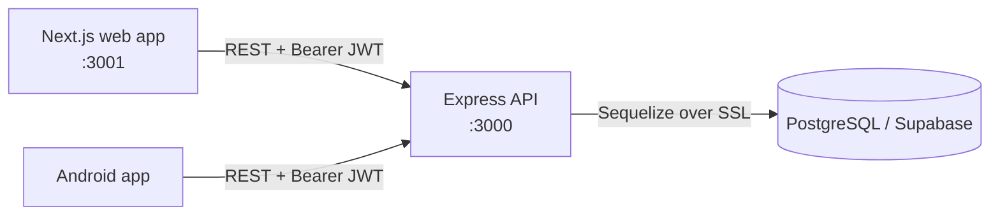

# B12 Health Tracker

A full-stack web app that estimates a person's risk of **vitamin B12 deficiency** from a short adaptive questionnaire, then helps them track symptoms over time with daily check-ins, trend charts, BMI logs and a B12 food guide.


> **Medical disclaimer:** B12 Health Tracker is for education and wellness tracking only. It does not diagnose any condition and is not a substitute for a doctor or a blood test.

---

## Features

| Area | What it does |
|---|---|
| **Risk assessment** | Adaptive questionnaire (common, clinical, age-specific and gender-specific questions) with a weighted scoring engine that returns a Low / Medium / High risk level, a per-category breakdown and personalised next steps. |
| **Guest mode** | Anyone can take the assessment without an account. The answers are kept on the device and submitted automatically after sign-up. |
| **Daily check-in** | A 30-second log of energy, fatigue, mood, sleep and focus (0–4 each), with streaks and optional notes. |
| **Progress** | 7 / 14 / 30-day charts for all five metrics, trend labels, pattern alerts and assessment history. |
| **Insights** | Server-generated insights from the latest assessment and the last 7 days of check-ins. |
| **Food guide** | Searchable list of B12-rich foods with per-serving micrograms and % of daily need. |
| **BMI** | BMI calculator with saved history. |
| **Account** | Profile editing, password change, logout with token revocation and permanent account deletion. |
| **Security** | JWT (HS256) with revocation, bcrypt, brute-force lockout, rate limiting, input sanitisation, audit log, Helmet/CSP and Row Level Security in Supabase. |

## Tech stack

| Layer | Technology |
|---|---|
| Web app | Next.js 16 (App Router), React 19, CSS Modules, Recharts, Framer Motion |
| API | Node.js 20, Express 4, Sequelize 6, express-validator, Winston |
| Database | PostgreSQL 16 (hosted on Supabase) |
| Auth | JSON Web Tokens + bcrypt |
| Tests | Jest + Supertest, scoring parity script |
| Hosting | Vercel (web, and optionally the API), Railway or Docker (API), Supabase (DB) |

## Architecture at a glance



See [docs/ARCHITECTURE.md](docs/ARCHITECTURE.md) for the full picture.

## Quick start

**Prerequisites:** Node.js 20+, npm, and a PostgreSQL database (a free [Supabase](https://supabase.com) project works).

1. **Create the database.** In the Supabase SQL editor, run [`B12-Project/backend/database/supabase_setup.sql`](B12-Project/backend/database/supabase_setup.sql). It creates every table, index and the question seed in one go.

2. **Configure and start the API.**

   ```bash
   cd B12-Project/backend/node-service
   cp .env.example .env    # then set DATABASE_URL and JWT_SECRET
   npm install
   npm run dev
   ```

   Generate a `JWT_SECRET` with:

   ```bash
   node -e "console.log(require('crypto').randomBytes(32).toString('hex'))"
   ```

   Check it is up: <http://localhost:3000/health>

3. **Configure and start the web app** (in a second terminal).

   ```bash
   cd B12-Project/frontend-web
   cp .env.example .env.local
   npm install
   npm run dev
   ```

   Open <http://localhost:3001>.

Full instructions, including Docker and a local Postgres, are in [docs/SETUP.md](docs/SETUP.md).

## Documentation

| Document | Contents |
|---|---|
| [docs/SETUP.md](docs/SETUP.md) | Local development, step by step |
| [docs/CONFIGURATION.md](docs/CONFIGURATION.md) | Every environment variable for the API and web app |
| [docs/ARCHITECTURE.md](docs/ARCHITECTURE.md) | Components, request lifecycle, data flow, design decisions |
| [docs/API.md](docs/API.md) | REST API reference with request and response examples |
| [docs/openapi.yaml](docs/openapi.yaml) | OpenAPI 3.0 spec (import into Swagger UI, Postman or Insomnia) |
| [docs/DATABASE.md](docs/DATABASE.md) | Schema, tables, relationships, migrations, maintenance |
| [docs/SCORING.md](docs/SCORING.md) | How the B12 risk score is calculated (v1 and v2) |
| [docs/FRONTEND.md](docs/FRONTEND.md) | Web app pages, user flow, state and local storage |
| [docs/SECURITY.md](docs/SECURITY.md) | Security controls in the API, web app and database |
| [docs/DEPLOYMENT.md](docs/DEPLOYMENT.md) | Deploying to Supabase, Railway, Vercel or Docker |
| [docs/TESTING.md](docs/TESTING.md) | Running the test suites and the scoring parity check |
| [docs/TROUBLESHOOTING.md](docs/TROUBLESHOOTING.md) | Common problems and fixes |
| [CONTRIBUTING.md](CONTRIBUTING.md) | Branching, code style, commit and PR guidelines |
| [SECURITY.md](SECURITY.md) | How to report a vulnerability |
| [CHANGELOG.md](CHANGELOG.md) | Release history |

## Repository layout

```text
B12/
├── README.md                 ← you are here
├── CHANGELOG.md · CONTRIBUTING.md · SECURITY.md · LICENSE
├── docs/                     ← project documentation
└── B12-Project/
    ├── frontend-web/         ← Next.js web app
    ├── backend/
    │   ├── node-service/     ← Express API
    │   └── database/         ← SQL migrations, seeds, supabase_setup.sql
    ├── scripts/              ← check-scoring-parity.mjs
    ├── docker-compose.yml    ← API + web containers (uses an external DB)
    └── .env.docker.example
```

## Scripts

| Location | Command | Purpose |
|---|---|---|
| `backend/node-service` | `npm run dev` | API with auto-reload (nodemon) |
| `backend/node-service` | `npm start` | API in production mode |
| `backend/node-service` | `npm test` | Jest + Supertest tests (needs a database) |
| `frontend-web` | `npm run dev` | Web app on port 3001 |
| `frontend-web` | `npm run build` / `npm start` | Production build and serve |
| `frontend-web` | `npm run lint` | ESLint |
| `B12-Project` | `node scripts/check-scoring-parity.mjs` | Verify web and server scoring agree |

## License

Released under the [MIT License](LICENSE).
