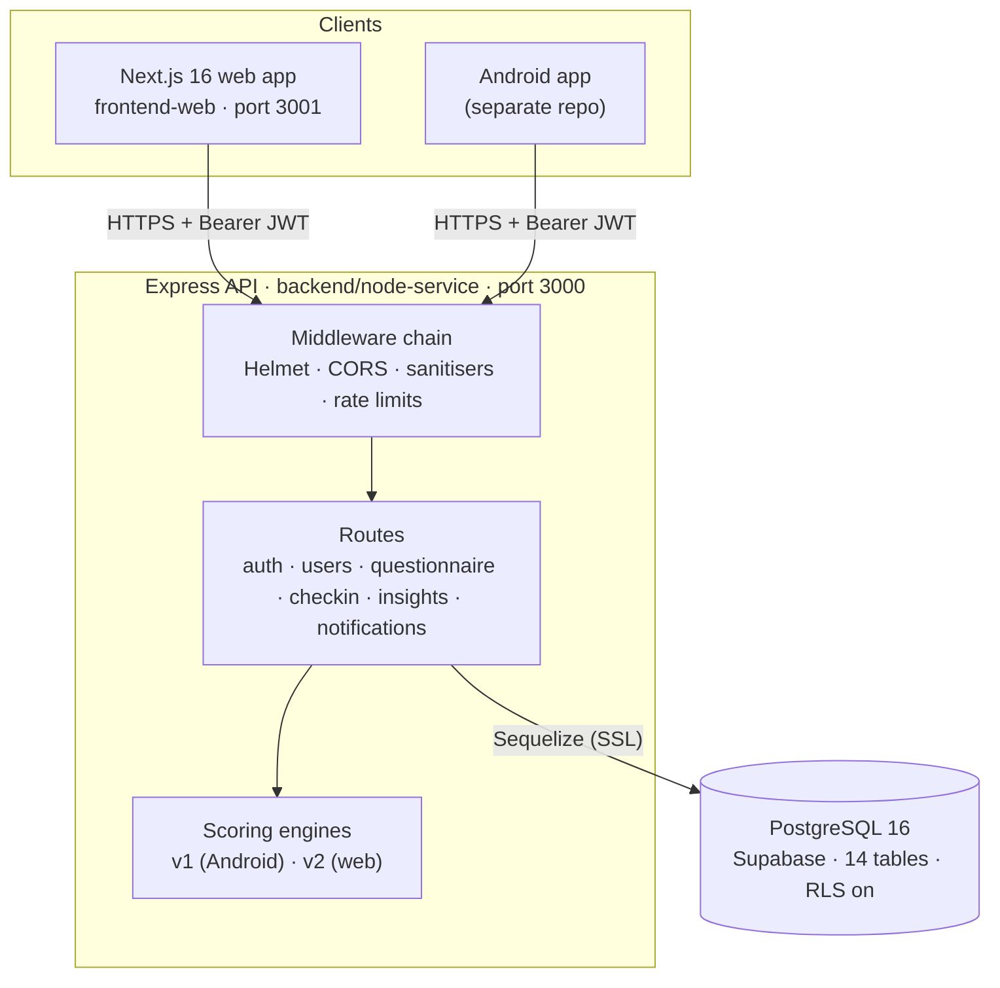
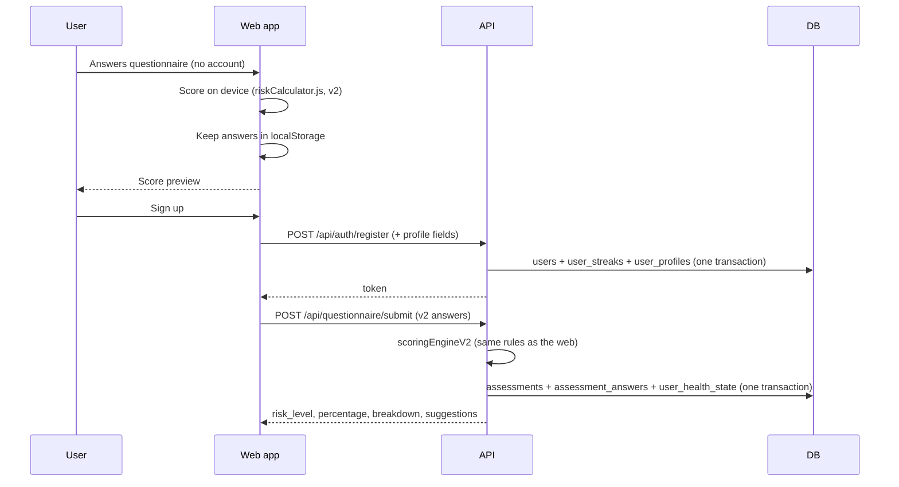

# Architecture

## System overview



| Component | Location | Responsibility |
|---|---|---|
| Web app | `B12-Project/frontend-web` | UI, guest questionnaire, on-device scoring preview, charts |
| API | `B12-Project/backend/node-service` | Auth, validation, scoring, persistence, insights |
| Database | `B12-Project/backend/database` | Schema, migrations, question seed |
| Scripts | `B12-Project/scripts` | Scoring parity check between web and server |

There is no separate scoring service. The original Python/FastAPI scorer was ported to JavaScript and now runs inside the API (`src/services/scoringEngine.js`). Some legacy files still mention it — see [Legacy files](#legacy-files).

## Backend structure

```text
backend/node-service/
├── server.js              Express app: middleware order, route mounting, startup
├── api/index.js           Vercel serverless entry (re-exports the app)
├── src/
│   ├── config/
│   │   ├── db.js          Sequelize instance, SSL + pool settings
│   │   └── validateEnv.js Fail-fast checks on env vars (runs first)
│   ├── middleware/
│   │   ├── auth.js        JWT verification, blacklist + active-user check
│   │   ├── rateLimiter.js apiLimiter, authLimiter, authSlowDown
│   │   ├── sanitize.js    XSS, NoSQL, HPP, prototype pollution, Content-Type guard
│   │   ├── auditLogger.js Writes security events to audit_logs + log file
│   │   ├── ownershipGuard.js  Reusable IDOR guard (not mounted on any route yet)
│   │   └── errorHandler.js    Safe error responses with correlation IDs
│   ├── models/            Sequelize models, one per table
│   ├── routes/            One router per resource
│   ├── services/
│   │   ├── scoringEngine.js     v1 scorer (numeric question IDs)
│   │   ├── scoringEngineV2.js   v2 scorer (question keys)
│   │   ├── questionBankV2.json  v2 bank generated from frontend-web/data/questions.js
│   │   └── scoringProxy.js      Thin adapter around the v1 scorer
│   └── utils/
│       ├── logger.js      Winston with secret masking
│       └── response.js    sendSuccess / sendError, age group + diet penalty helpers
└── tests/                 Jest + Supertest
```

## Request lifecycle

Every request passes through the middleware in this order (`server.js`):

| # | Layer | Effect |
|---|---|---|
| 1 | `validateEnv()` | Runs once at startup; the process exits if `JWT_SECRET` or the DB URL is missing or weak |
| 2 | `trust proxy = 1` | `req.ip` is the real client IP behind one proxy |
| 3 | Helmet | CSP, HSTS, `nosniff`, `no-referrer`, hides `X-Powered-By` |
| 4 | CORS | Origin allow-list (`ALLOWED_ORIGINS`); requests with no `Origin` are allowed |
| 5 | Content-Type guard | `POST/PUT/PATCH` with a body must be JSON (`415` otherwise) |
| 6 | `express.json` | Parses bodies up to 100 KB |
| 7 | Sanitisers | XSS clean (skips password fields), NoSQL operator strip, HPP, prototype-pollution strip |
| 8 | Morgan | Access log (no bodies, `/health` skipped) |
| 9 | `apiLimiter` | All `/api/*` |
| 10 | `authSlowDown` + `authLimiter` | `/api/auth/login` and `/api/auth/register` only |
| 11 | Router | Route-level `authMiddleware` + `express-validator` rules |
| 12 | 404 handler / `errorHandler` | Uniform error JSON |

## Key data flows

### Guest assessment → account



Because the web app and the server use the same v2 rules and question bank, the preview a guest sees is the score that gets saved. `scripts/check-scoring-parity.mjs` checks this.

### Daily check-in

1. Web app sends five 0–4 scores and the user's local date.
2. API resolves the date (accepts ±1 day of UTC), upserts `daily_checkins` on `(user_id, checkin_date)`.
3. Streak is updated in `user_streaks` (consecutive day → +1, gap → 1, same day → unchanged).
4. `user_health_state.current_*` columns are overwritten with today's scores.

### Authentication

1. Login verifies the bcrypt hash (a dummy hash is compared when the email is unknown, so timing does not reveal valid emails).
2. A JWT is issued with a random `jti`.
3. Each protected request verifies the signature, then looks up the blacklist and the user in parallel.
4. Logout writes the `jti` to `token_blacklist` until the token's own expiry.

See [SECURITY.md](SECURITY.md) for every control.

## Design decisions

| Decision | Reason |
|---|---|
| **One API for web and Android** | One source of truth for accounts and health data; both apps stay in sync. |
| **Two scoring versions side by side** | The Android app sends numeric question IDs (v1). The web app uses a richer keyed bank (v2). Each assessment stores its `scoring_version`. |
| **Profile snapshot on each assessment** | Changing the profile later does not rewrite history, and every row is usable for ML export. |
| **`assessment_answers` denormalised** | Category, weight and question text are copied per answer so the table can be exported for model training without joins. |
| **JWT in `localStorage` (web)** | Same contract as the Android app's AsyncStorage. CSP and input sanitisation reduce XSS risk; tokens can be revoked server-side. |
| **Stateless API** | Works as a long-running server (Railway/Docker) or as Vercel serverless functions. Rate-limit counters are in memory, so they are per instance. |
| **RLS enabled with no policies** | Supabase's auto-generated REST API cannot read any table; the API connects as the table owner and is unaffected. |

## Legacy files

These are from the earlier Python + PM2 setup and do not reflect the current architecture:

| File | Status |
|---|---|
| `backend/ecosystem.config.js` | PM2 config that still starts a Python service under `D:\B12\backend-v2` |
| `backend/setup.ps1`, `status.bat`, `logs.bat`, `restart.bat` | Windows helpers for the PM2 setup |
| `backend/docker-compose.yml` | Local Postgres + API; mounts migrations 001–006 only (not 007) |
| `backend/node-service/.env.example` → `FASTAPI_URL`, `ENABLE_MONGODB`, `MONGODB_URL` | Not read by the current code |
| `MIGRATION_PLAN.md.resolved`, `improvement.txt` | Planning notes from the Android → web migration |
