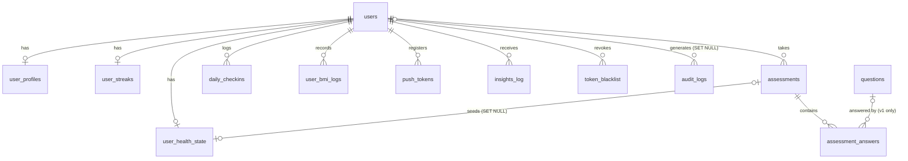

# Database

PostgreSQL 16, hosted on Supabase in production. The API talks to it through Sequelize (`src/models/*`). Sequelize never creates or alters tables — the schema is managed by the SQL files below.

## Files

| File | Purpose |
|---|---|
| `backend/database/supabase_setup.sql` | **One-shot setup.** Migrations 001–007 plus the question seed in one script. Safe to re-run (`IF NOT EXISTS`). |
| `backend/database/migrations/001_core.sql` | `users`, `user_profiles`, `push_tokens` |
| `…/002_questionnaire.sql` | `questions`, `assessments`, `assessment_answers` |
| `…/003_checkin_streak.sql` | `daily_checkins`, `user_streaks`, `insights_log` |
| `…/004_bmi.sql` | `user_bmi_logs` |
| `…/005_user_health_state.sql` | `user_health_state` |
| `…/006_security.sql` | `token_blacklist`, `login_attempts`, `audit_logs`, cleanup functions |
| `…/007_launch_hardening.sql` | Row Level Security, duplicate-index removal, nightly cleanup job |
| `backend/database/seeds/questions_seed.sql` | The 25 v1 questions used by the Android app |

### Applying changes

- **New database:** run `supabase_setup.sql`.
- **Existing database:** run only the migrations you have not applied yet, in order.
- **Adding a migration:** create `00N_short_name.sql`, make it idempotent (`IF NOT EXISTS`, `CREATE OR REPLACE`, `DROP … IF EXISTS`), then append the same SQL to `supabase_setup.sql` so new installs get it.

There is no migration-tracking table; keep a note of what each environment has applied.

## Entity relationships



Every child table uses `ON DELETE CASCADE` on `user_id`, so deleting a user removes all of their data. `audit_logs.user_id` is `ON DELETE SET NULL` so the security trail survives. `login_attempts` is keyed by email, not user.

## Tables

### `users`

| Column | Type | Notes |
|---|---|---|
| `id` | UUID PK | `gen_random_uuid()` |
| `email` | VARCHAR(255) UNIQUE NOT NULL | Stored normalised (lower case) |
| `password_hash` | VARCHAR(255) | bcrypt, cost 12. NULL reserved for future OAuth users |
| `google_id` | VARCHAR(255) UNIQUE | Reserved for Google sign-in |
| `is_active` | BOOLEAN default `true` | `false` blocks all access |
| `created_at`, `updated_at` | TIMESTAMPTZ | |

### `user_profiles` (1 : 1 with users)

| Column | Type | Notes |
|---|---|---|
| `user_id` | UUID UNIQUE FK | |
| `name` | VARCHAR(255) | |
| `age` | SMALLINT | 1–119 |
| `age_group` | VARCHAR(10) | `15-24` · `25-40` · `41-60` · `60+` · `all` |
| `gender` | VARCHAR(20) | `male` · `female` · `other` |
| `diet_type` | VARCHAR(20) | `vegan` · `vegetarian` · `pescatarian` · `omnivore` |
| `diet_penalty_score` | SMALLINT | 12 / 8 / 4 / 0 |
| `has_pernicious_anemia`, `has_crohns_disease`, `has_celiac_disease`, `has_gastric_surgery`, `has_ibs` | BOOLEAN | Medical conditions |
| `takes_metformin`, `takes_ppi` | BOOLEAN | Medications |
| `is_pregnant`, `is_breastfeeding` | BOOLEAN | |
| `alcohol_frequency`, `smoking_status` | VARCHAR(20) | |

### `questions` (v1 bank)

| Column | Type | Notes |
|---|---|---|
| `id` | SERIAL PK | Referenced by the Android app |
| `question_text` | TEXT | |
| `category` | VARCHAR(30) | `diet` · `neurological` · `energy` · `digestive` · `lifestyle` · `psychological` |
| `audience` | VARCHAR(20) | `all` · `male` · `female` |
| `age_group` | VARCHAR(20) | `all` or a specific group |
| `weight` | NUMERIC(4,2) | Importance multiplier |
| `max_option_score` | NUMERIC(4,2) | |
| `options` | JSONB | `[{ "label": "Never", "value": "never", "score": 0 }, …]` |
| `is_active`, `display_order` | | |

The v2 bank used by the web app is **not** in the database; it lives in `questionBankV2.json`.

### `assessments`

One row per completed questionnaire.

| Group | Columns |
|---|---|
| Profile snapshot | `age_at_assessment`, `age_group`, `gender`, `diet_type`, `diet_penalty_score`, `has_*`, `takes_*` |
| Result | `raw_score`, `max_possible_score`, `normalized_score` (0–100), `risk_percentage` (same), `risk_level` (`low`/`medium`/`high`), `category_breakdown` JSONB, `suggestions` JSONB |
| Blood test / ML labels | `lab_b12_value_pmol` (serum B12 the user entered, always pmol/L) and `ml_label` (`deficient` < 148 · `borderline` 148–221 · `normal` > 221 pmol/L), set by `PUT /api/questionnaire/:id/lab`; `doctor_confirmed` is reserved |
| Metadata | `questions_shown`, `scoring_version` (`1.0` or `2.0`), `completed_at` |

### `assessment_answers`

One row per answer — the main ML training table.

| Column | Notes |
|---|---|
| `assessment_id`, `user_id` | FKs (user is denormalised for export) |
| `question_id` | v1 question ID; `NULL` for v2 answers |
| `answer_value`, `answer_label` | Raw value and label at answer time |
| `answer_score`, `question_weight` | Snapshot of scoring inputs |
| `weighted_score` | Generated: `answer_score * question_weight` |
| `question_category`, `question_text_snapshot` | For v2, the text is prefixed with `[questionKey]` |

### `daily_checkins`

| Column | Notes |
|---|---|
| `checkin_date` | DATE; `UNIQUE (user_id, checkin_date)` |
| `energy_score`, `fatigue_score`, `mood_score`, `sleep_score`, `focus_score` | SMALLINT 0–4 (CHECK constraint). Fatigue: higher is worse. |
| `total_score` | Generated sum (0–20) |
| `notes`, `duration_seconds` | Optional |

### `user_streaks` (1 : 1)

`current_streak`, `longest_streak`, `total_checkins`, `last_checkin_date`. Created at registration.

### `user_health_state` (1 : 1)

A "living" summary row: the baseline from the latest assessment (`baseline_risk_level`, `baseline_risk_score`, profile snapshot, `assessment_id`) plus the latest check-in (`current_*_score`, `current_daily_total`, `last_checkin_date`, `total_checkins`). Created on the first assessment and updated on each check-in.

### `user_bmi_logs`

`height_cm` (50–300), `weight_kg` (10–500), `bmi`, `bmi_category`, `measured_at`.

### `push_tokens`

Expo push tokens, `UNIQUE (user_id, token)`, `platform`, `is_active`.

### `insights_log`

Reserved for recording shown insights. The API does not write to it yet — insights are computed on each request.

### Security tables

| Table | Purpose | Retention (cleanup job) |
|---|---|---|
| `token_blacklist` | `jti` of logged-out tokens with their `expires_at` | Until expiry |
| `login_attempts` | Every login attempt: email, IP (`INET`), success | 90 days |
| `audit_logs` | Security events: `LOGIN`, `LOGOUT`, `FAILED_LOGIN`, `ACCOUNT_LOCKED`, `REGISTER`, `PASSWORD_CHANGE`, `TOKEN_REFRESH`, `ACCOUNT_DELETED`, `IDOR_ATTEMPT`, `UNAUTHORIZED_ACCESS` with IP, user agent, metadata | 365 days |

## Row Level Security

Migration 007 enables RLS on every table with **no policies**, and revokes all privileges from Supabase's `anon` and `authenticated` roles. This closes Supabase's auto-generated REST API, which would otherwise expose `password_hash` and health data to anyone with the project's anon key.

The Node API connects as the table owner (`postgres`), which bypasses RLS, so it is unaffected. Do not connect the web app to Supabase directly.

## Maintenance

`cleanup_security_tables()` deletes expired blacklist entries and old login attempts and audit logs. Migration 007 schedules it nightly at 03:15 UTC if the `pg_cron` extension is enabled (Supabase: **Database → Extensions → pg_cron**, then re-run 007). To run it by hand:

```sql
SELECT cleanup_security_tables();
```

## Exporting data for ML

```sql
SELECT
  aa.user_id, aa.question_id, aa.question_category,
  aa.answer_value, aa.answer_score, aa.question_weight, aa.weighted_score,
  a.age_at_assessment, a.age_group, a.gender, a.diet_type, a.diet_penalty_score,
  a.has_pernicious_anemia, a.takes_metformin,
  a.normalized_score, a.risk_level, a.scoring_version,
  a.ml_label
FROM assessment_answers aa
JOIN assessments a ON aa.assessment_id = a.id
ORDER BY aa.answered_at;
```

In `psql`, wrap it in `\COPY (…) TO 'training_data.csv' CSV HEADER;`. Filter by `scoring_version` — v1 and v2 use different question sets. Health data is sensitive: remove `user_id` or pseudonymise it before sharing an export.
