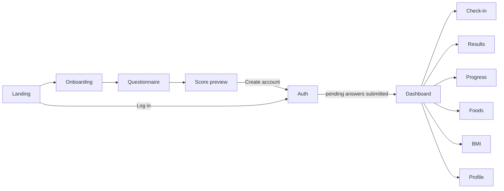

# Web App (frontend-web)

Next.js 16 App Router app, JavaScript, React 19, CSS Modules. All pages are client components that call the API through `services/api.js`.

> Next.js 16 has breaking changes from earlier versions. Read the bundled docs in `node_modules/next/dist/docs/` before using an API you have not used in this project.

## Structure

```text
frontend-web/
├── app/                    Routes (one folder per page, each with page.js + page.module.css)
│   ├── layout.js           Root layout: font, metadata, <Providers>
│   ├── page.js             Landing page (redirects signed-in users to /dashboard)
│   ├── error.js · not-found.js · robots.js · sitemap.js
│   └── <route>/page.js
├── components/
│   ├── Providers.js        MotionConfig → App → Auth → Toast providers
│   ├── auth/AuthGuard.js   Redirects signed-out users to /auth?mode=login
│   ├── layout/             AppShell (signed-in layout), TabBar (navigation)
│   ├── questionnaire/      QuestionVisual (illustrations)
│   ├── QuestionExplainer.js "Why we ask" panel
│   └── UI/                 Skeleton, EmptyState, ErrorState, Toast, RiskGauge, …
├── context/
│   ├── AuthContext.js      Token, login/register/logout, syncs pending guest answers
│   └── AppContext.js       Guest flow + cached server data (useReducer)
├── data/
│   ├── questions.js        v2 question bank, buildQuestionSet(), daily check-in questions
│   ├── questionnaireSections.js · questionnaireInterstitials.js
│   └── b12Foods.js         Food guide data
├── services/api.js         fetch wrapper + authAPI, usersAPI, questionnaireAPI, checkinAPI, insightsAPI
├── utils/riskCalculator.js v2 scoring (mirrors the server)
└── next.config.mjs         Security headers and CSP
```

## Pages

| Route | Access | Purpose |
|---|---|---|
| `/` | Public | Landing page, FAQ. Signed-in users go to `/dashboard`. |
| `/onboarding` | Public | Intro slides and guest profile (name, age, gender, diet) |
| `/questionnaire` | Public | Adaptive questionnaire with explainers, section stepper, keyboard shortcuts (1–5, Enter, ←) and resume |
| `/score-preview` | Public | Guest result and sign-up prompt |
| `/auth` | Public | Login / register (`?mode=login` or `?mode=register`) |
| `/foods` | Public (inside the app shell when signed in) | B12 food guide |
| `/privacy`, `/terms` | Public | Legal pages |
| `/dashboard` | Signed in | Risk summary, 7-day check-in strip, streak, insights |
| `/checkin` | Signed in | Daily 5-question check-in with review step and notes |
| `/progress` | Signed in | 7 / 14 / 30-day charts, pattern alerts, assessment history |
| `/results` | Signed in | Full report: drivers, next steps, when to see a doctor, **add / edit a blood test result** (`app/results/LabResultCard.js`), history |
| `/report` | Signed in | One-page A4 **doctor report**: patient details, score + drivers, blood test, relevant history, answers that raised the score, 14-day check-in chart. "Save as PDF / Print" uses the browser's print-to-PDF (crisp vector text, no PDF library). |
| `/bmi` | Signed in | BMI calculator and history |
| `/profile` | Signed in | Edit profile, change password, log out, delete account |

## User flow



A guest's answers are stored as `pendingAnswers`. After register or login, `AuthContext` submits them to `POST /api/questionnaire/submit`. If that fails they are kept and retried from the dashboard or results page.

## State

| Store | Contents |
|---|---|
| `AuthContext` | `isAuthenticated`, `isLoading`, current user, auth actions |
| `AppContext` | `user` (guest profile), `guestName`, `onboardingDone`, `riskResult`, `pendingAnswers`, `bmiData`, and cached server data (`serverStreak`, `serverInsights`, `serverCheckinHistory`) |

State is loaded from `localStorage` after mount (not during render) to avoid hydration mismatches.

### Browser storage keys

| Key | Contents |
|---|---|
| `b12_token` | JWT |
| `b12_app_state` | Persisted subset of `AppContext`: `user`, `guestName`, `onboardingDone`, `riskResult`, `pendingAnswers`, `bmiData` |
| `b12_questionnaire_progress` | In-progress questionnaire, for resume |

## API client

`services/api.js`:

- Prefixes every path with `NEXT_PUBLIC_API_URL`.
- Adds `Authorization: Bearer <b12_token>` unless `auth: false`.
- Times out after 15 seconds.
- Throws `ApiError` (`message`, `status`, `data`) with friendly messages for network errors, `429` and `5xx`.
- On any `401` with a token, fires the `b12:unauthorized` window event. `AuthContext` listens and signs the user out.

To add an endpoint, add a method to the matching `*API` object and document it in [API.md](API.md).

## Styling

- CSS Modules per page/component, global tokens in `app/globals.css` (CSS custom properties).
- **Light theme only, by design.** `color-scheme: light` (plus `viewport.colorScheme`) stops browsers auto-darkening the page. A dark mode would mean replacing ~270 hard-coded colours across the pages with tokens first.
- **Contrast:** body text must reach 4.5:1 on every background. `--text-muted` (`#616C65`) is the lightest text colour that passes on the cream page and all pastel cards — don't use anything lighter for text.
- Use `className="visually-hidden"` for text that only screen readers should see (e.g. a section heading).
- Each page needs exactly one `<main>` landmark (`AppShell` provides it for signed-in pages).
- Inter is self-hosted via `@fontsource-variable/inter`.
- Respect `prefers-reduced-motion` for any new animation (Framer Motion is used for transitions). Shared pieces: `components/motion.js`, `AmbientBackground`, `CursorGlow`.

## Security headers

`next.config.mjs` sets CSP (`connect-src` limited to `'self'` and the API URL, `frame-ancestors 'none'`), HSTS, `X-Frame-Options: DENY`, `nosniff`, a strict referrer policy and a restrictive `Permissions-Policy`. If the web app needs to call another origin, add it to `connect-src`.
